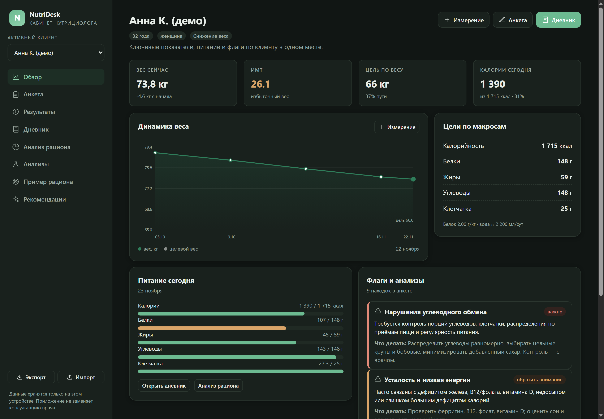
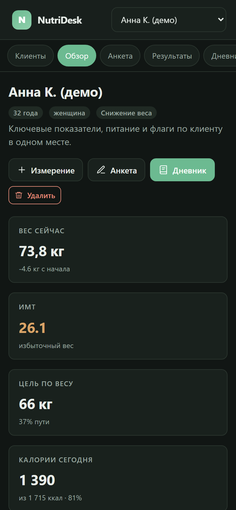
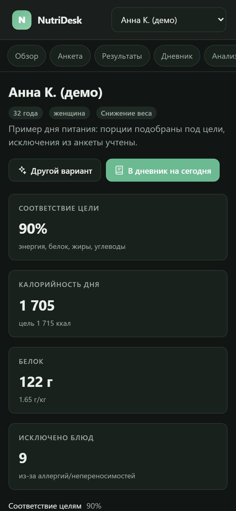

# NutriDesk — кабинет нутрициолога

Мобильное и настольное офлайн-приложение для ведения клиентов: анкета с анамнезом, дневник питания,
графики анализов, автоматический анализ рациона, рекомендации по макро- и микронутриентам и готовые примеры
рациона под цель клиента. Работает в браузере, устанавливается как приложение (PWA), данные хранятся локально.



## Онлайн-версия (GitHub Pages)

Публичная версия приложения размещается на GitHub Pages:
**[https://qazwsxed3c.github.io/nutri-desk/](https://qazwsxed3c.github.io/nutri-desk/)**

Репозиторий: [github.com/qazwsxed3c/nutri-desk](https://github.com/qazwsxed3c/nutri-desk).

После публикации сайт работает по HTTPS, устанавливается как PWA на телефон и компьютер и работает офлайн
после первого открытия (service worker). Данные, как и раньше, хранятся только в браузере пользователя.

## Что умеет

1. **Анкета с анамнезом** — жалобы, состояния и диагнозы, лекарства, аллергии и непереносимости, тип питания,
   сон, заметки. Приложение проверяет анкету по правилам и подсвечивает важные флаги (усталость, тяга к сладкому,
   выпадение волос, инсулинорезистентность, ИМТ, темп снижения веса и т. д.).
2. **Результаты клиента** — вес, талия, процент жира, самочувствие; графики динамики, цель по весу, история измерений.
3. **Анализ рациона** — среднее потребление за 1 / 7 / 30 дней: калории, белки, жиры, углеводы, клетчатка,
   распределение по приёмам пищи, топ продуктов и автоматические флаги.
4. **Дневник питания** — добавление продуктов по приёмам пищи (завтрак, обед, ужин, перекус), свой справочник
   продуктов, контроль калорий и макросов в реальном времени.
5. **Графики анализов** — 23 показателя с ориентировочными референсными диапазонами, динамикой и отметками
   отклонений; можно добавлять анализы и смотреть историю по каждому показателю.
6. **Рекомендации по макро- и микронутриентам** — цели по калориям, белкам, жирам, углеводам, клетчатке, воде
   и микроэлементам, сравнение с исходным рационом, продукты-источники дефицитов.
7. **Пример рациона** — завтрак, обед, ужин и перекус под цель клиента, с граммовками, КБЖУ, процентом
   соответствия цели и учётом аллергий/непереносимостей. План можно записать в дневник или сгенерировать другой вариант.

Дополнительно: добавление и удаление клиентов (раздел «Клиенты» в меню), экспорт/импорт резервной копии JSON,
тёмная и светлая темы, печать страниц, адаптивная вёрстка для телефона и компьютера, работа офлайн после первого открытия.

| Телефон | Рацион |
| --- | --- |
|  |  |

## Быстрый старт

Приложению нужен любой статический веб-сервер (ES-модули не открываются напрямую через `file://`).
Сборка не требуется — это обычные HTML/CSS/JS.

**Самый простой способ (Windows):** дважды щёлкните файл **`start.cmd`** в папке `nutri-app`.
Он сам подберёт PowerShell, Node.js или Python (включая встроенные в DSH), запустит сервер и откроет браузер.
Окно консоли должно оставаться открытым, пока вы пользуетесь приложением; остановка — `Ctrl+C`.

Через PowerShell:

```powershell
# из папки nutri-app
.\serve.ps1
```

Или вручную:

```bash
python -m http.server 8788 --bind 127.0.0.1
# откройте http://127.0.0.1:8788
```

`serve.ps1` сам подберёт Node.js или Python и запустит сервер. Также подойдёт
`npx serve .`, VS Code Live Server или любой другой статический сервер.

> Важно: не открывайте `index.html` двойным щелчком — по `file://` браузер блокирует ES-модули,
> и приложение останется пустым. Нужен именно сервер (`start.cmd` / `serve.ps1` / `python -m http.server`).

### Если не запускается

1. **Двойной щелчок по `serve.ps1` открывает Блокнот или PowerShell пишет «выполнение сценариев отключено»** —
   используйте `start.cmd`: он запускает скрипт с `-ExecutionPolicy Bypass` и не требует менять политику системы.
2. **Страница пустая / «Не удаётся получить доступ к этому сайту»** — сервер не запущен или был закрыт.
   Снова запустите `start.cmd` и откройте адрес, который он напечатал (по умолчанию http://127.0.0.1:8788/).
3. **Порт 8788 занят** — запустите на другом порту: `start.cmd 8789` и откройте http://127.0.0.1:8789/.
4. **Браузер не открылся автоматически** — откройте адрес из окна консоли вручную.
5. **Антивирус/SmartScreen блокирует `start.cmd`** — разрешите запуск или выполните в PowerShell:
   `powershell -NoProfile -ExecutionPolicy Bypass -File .\serve.ps1`.
6. **Показывается старая версия после обновления файлов** — нажмите `Ctrl+F5`; при необходимости поднимите
   версию кеша в `sw.js` (`const CACHE = 'nutridesk-v2'`).

При первом запуске загружаются два демо-клиента (Анна и Игорь) с анкетой, измерениями, анализами и дневником.
Их можно удалить и начать с чистого списка; демо-данные загружаются заново кнопкой «Загрузить демо-данные».

## Установка на компьютер и телефон

Приложение — PWA: его можно установить как обычное приложение.

- **Компьютер (Chrome / Edge)**: откройте адрес, нажмите иконку установки в адресной строке или
  «…» → «Установить приложение».
- **Android (Chrome)**: меню → «Добавить на главный экран» / «Установить приложение».
- **iPhone / iPad (Safari)**: «Поделиться» → «На экран „Домой“».

### Android APK

Для телефона также собран отдельный установочный файл:
[apk/NutriDesk-1.0.3.apk](apk/NutriDesk-1.0.3.apk) (копия — `NutriDesk-1.0.3.apk` в корне рабочей папки).
Это WebView-обёртка с тем же интерфейсом, встроенными ассетами и работой без интернета.

- Требования: Android 5.0+ (minSdk 21) и обновлённый Android System WebView (обычно обновляется через Play).
- Подпись APK: v1 + v2 + v3 — для совместимости со старыми и сторонними установщиками.
- APK подписан debug-сертификатом (для личной установки; для магазина приложений нужен release-keystore).
- Установка: перекиньте файл на телефон (USB, облако, Telegram) → откройте в файловом менеджере →
  разрешите установку из этого источника. Play Protect может предупредить, так как APK не из магазина.
- Данные хранятся внутри приложения (`localStorage` WebView), резервная копия — через «Экспорт»
  (откроется системный диалог сохранения JSON).
- Пересборка и детали сборки — в [apk/BUILD.md](apk/BUILD.md).

Чтобы открыть приложение на телефоне в той же Wi-Fi сети, запустите сервер с доступом по сети:

```bash
python -m http.server 8788 --bind 0.0.0.0
# затем на телефоне откройте http://<IP-компьютера>:8788
```

Обратите внимание: полноценный офлайн-режим и установка PWA требуют **HTTPS** (или `localhost` на самом
устройстве). Для телефона проще всего разместить папку `nutri-app` на любом HTTPS-хостинге
(GitHub Pages, Netlify, Vercel, Cloudflare Pages). Данные при этом всё равно остаются на устройстве:
сервер отдаёт только файлы приложения, ничего не сохраняет.

## Где хранятся данные

- Всё хранится в `localStorage` браузера под ключом `nutridesk.v1` — без аккаунтов, облака и сервера.
- «Экспорт» сохраняет резервную копию `nutridesk-backup-ГГГГ-ММ-ДД.json`; «Импорт» восстанавливает её.
- Очистка данных браузера/сайта удалит записи. Делайте резервные копии, особенно перед сменой устройства.
- На одном устройстве может работать несколько клиентов: раздел «Клиенты» в меню — добавление, удаление,
  переключение (на телефоне — первая вкладка и селектор в шапке).

## Как считаются цели

Расчёты ориентировочные и не заменяют консультацию врача или диетолога.

- **Основной обмен** — формула Миффлина–Сан Жеора; расход = ОО × коэффициент активности (1,2–1,9).
- **Калорийность** — дефицит 15 % для снижения веса, профицит 10 % для набора, поддержание для цели «сохранить».
- **Белок** — 2,0 г/кг при снижении, 1,6 г/кг при поддержании, 1,8 г/кг при наборе (с поправкой на активность).
- **Жиры** — 0,8–0,9 г/кг, **углеводы** — остаток калорий; **клетчатка** — 14 г на 1000 ккал (25–45 г).
- **Вода** — около 30 мл/кг; **натрий** — до 2000 мг (до 1500 мг при гипертонии).
- **Микронутриенты** — ориентировочные нормы для взрослых (кальций, железо, магний, калий, витамины C, B12,
  фолат, омега-3 ALA) с поправкой на пол.
- **Пример рациона** — блюда масштабируются под долю калорий приёма пищи, при необходимости добавляется белок;
  блюда с аллергенами и исключениями клиента не используются.

## Структура проекта

```text
nutri-app/
├─ index.html                 # оболочка приложения
├─ start.cmd                  # запуск в один клик (Windows)
├─ serve.ps1                  # запуск через PowerShell
├─ apk/                       # готовый Android APK
├─ manifest.webmanifest       # PWA-манифест
├─ sw.js                      # service worker (офлайн-кеш)
├─ css/app.css                # адаптивные стили, светлая/тёмная темы
├─ icons/                     # иконки приложения
├─ js/
│  ├─ app.js                  # маршрутизация, оболочка, модалки, тосты, PWA
│  ├─ data/
│  │  ├─ foods.js             # справочник продуктов и аллергенов
│  │  ├─ meal-templates.js    # шаблоны блюд для примера рациона
│  │  └─ labs.js              # показатели анализов и референсы
│  ├─ core/
│  │  ├─ format.js            # даты, числа, склонения
│  │  ├─ nutrition.js         # цели, анализ рациона, генератор плана
│  │  └─ store.js             # localStorage, CRUD, демо-данные
│  └─ ui/
│     ├─ charts.js            # SVG-графики без зависимостей
│     ├─ components.js        # UI-примитивы
│     ├─ forms.js             # формы клиента, измерений, анализов, продуктов
│     ├─ shared.js            # шапка клиента, дисклеймер, модалки
│     └─ views/               # экраны приложения
├─ test/                      # Node-тесты
├─ tools/                     # генератор иконок и скрипт скриншотов
└─ preview/                   # скриншоты для документации
```

## Тесты

```bash
npm test
# или по отдельности:
node test/core.test.mjs       # расчёты, анализ, генератор рациона
node test/imports.test.mjs    # импорт модулей, хранилище, CRUD
node test/views.test.mjs      # рендер всех экранов и ключевые блоки
```

Всего 24 теста: цели, анализ анкеты, макросы/микронутриенты, генератор рациона и исключения, лабораторные статусы,
CRUD клиентов/измерений/дневника/анализов, рендер каждого раздела.

## Ограничения

- Не медицинское изделие: приложение помогает организовать данные и увидеть закономерности, но не ставит диагноз
  и не назначает лечение. Референсные диапазоны анализов ориентировочные и могут отличаться от бланка лаборатории.
- Нет облачной синхронизации и авторизации: данные живут на одном устройстве (резервная копия — JSON).
- Оценки КБЖУ продуктов и блюд приблизительные; при необходимости добавляйте свои продукты.
- Рекомендации по добавкам не заменяют назначение врача.

## Идеи развития

- PDF-отчёты для клиента и печать дневника за период.
- Импорт дневника из CSV/фото, распознавание продуктов.
- Синхронизация между устройствами и роли «нутрициолог — клиент».
- Нативные обёртки: APK для Android уже собран; iOS/Electron — при необходимости.
- Расширение базы рецептов и учёт сезонности продуктов.

